# Session report

**Тестер:** Э.Батхүлэг  
**Огноо:** 2026-10-19  
**Session:** 21:41–22:41 (60 минут; таймер дууссан)  
**Charter commit:** 2026-10-19 21:27 (+08), session-ээс өмнө  
**Mission:** Уншлагын жагсаалтын үндсэн хэрэглэгчийн урсгал, оролтын шалгалт, хайлт, тоолуур болон API-ийн зан төлөвөөс спецификацтай зөрөх согог илрүүлэх.

## Цагийн задаргаа

| Хугацаа | Зарцуулсан цаг | Үйл ажиллагаа |
|---|---:|---|
| 21:41–21:58 | 17 минут | GUI-ийн эхний төлөв, талбар дутуу нэмэх, хайлт, хүснэгт/тоолуур, устгал, хуучин хувилбарын холбоос |
| 21:58–22:03 | 6 минут | Оны хил хязгаар ба бүхэл тооны шалгалт, давхардсан ном |
| 22:04–22:07 | 4 минут | Буруу JSON API хүсэлт, зохиогчийн хайлтын үсгийн хэмжээ |
| 22:08–22:37 | 30 минут | Тестерийн мэдээлснээр үргэлжлүүлэн exploratory шалгалт хийсэн; тус бүрийн үйлдлийг энэ raw тэмдэглэлд нарийвчлан буулгаагүй |
| 22:38–22:41 | 3 минут | Бүхэл бус жилийн шалгалт, session-ийг хаах |
| **Нийт** | **60 минут** | Таймер тасралтгүй ажилласан; тестер саад, тасалдал гараагүй гэж мэдээлсэн |

## Сонгосон аялалууд

Charter-д заасан аяллууд: Supermodel (GUI), Couch Potato (хоосон/хил орчмын оролт), Saboteur (API).

## Түүхий тэмдэглэл

- **21:41 — Эхний хэмжилт, үндсэн дэлгэц.** Аппыг шинээр асаасны дараа хүснэгтэд 3 номын мөр харагдсан. Тоолуур “Нийт ном: 4” гэж харуулав. Оны утгууд `1,971`, `2,008`, `1,999` гэж таслалтай харагдав. `Устгах` товчнууд ногоон өнгөтэй байв. Эдгээр нь ажиглалт; тус бүрийг session-ий явцад дахин шалгаж, bug report-д оруулах эсэхийг баталгаажуулна. Screenshot дээр Clock цонх `1 min` болон `00:59:53` гэж харагдаж байна.

  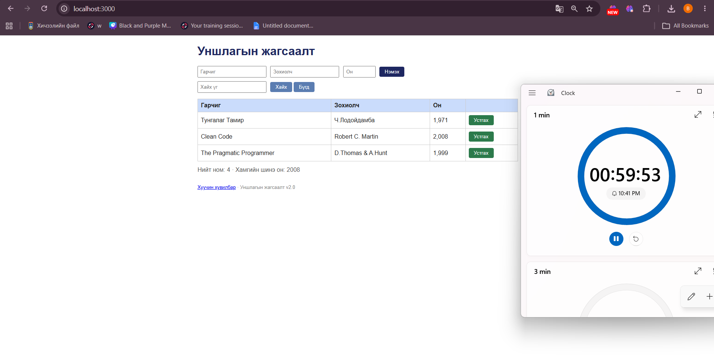

- **21:48 — Бүх талбарыг хоосон үлдээгээд “Нэмэх” дарав.** Хоосон гарчиг, зохиолчтой шинэ мөр хүснэгтэд нэмэгдэв; он `0` гэж харагдав. “Ном нэмэгдлээ” гэсэн амжилтын мессеж гарч, тоолуур 5 болов. Үйлдлийн өмнө 3 анхны ном харагдаж байсан тул үйлдлийн дараах хүснэгтэд 4 мөр байна. Хүлээгдсэн нь: дутуу талбарт ном нэмэгдэхгүй, алдааны мессеж гарах. Ажиглалт нь шаардлагатай талбарын шалгалт ажиллахгүй байж болзошгүйг харуулж байна; bug report болгохын өмнө шинээр асаасан апп дээр дахин баталгаажуулна.

  Screenshot: `screenshots/bug-02.png` (энэ зурваст хавсаргасан зургийг энэ нэрээр хадгална).

- **21:50 — Зөвхөн гарчиг бөглөөд (“Test Book”), зохиолч ба оныг хоосон үлдээн “Нэмэх” дарав.** Ном нэмэгдэж, зохиолч хоосон, он `0` болсон шинэ мөр хүснэгтэд харагдав. “Ном нэмэгдлээ” мессеж гарч, тоолуур 6 болов. Хүлээгдсэн нь шаардлагатай гурван талбараас зохиолч, он дутуу тул нэмэхгүй байх. Энэ нь 21:48-д ажигласан шаардлагатай талбар шалгахгүй байгаа зан үйлийг дахин баталж байна; нэг bug report-д нэгтгэнэ.

  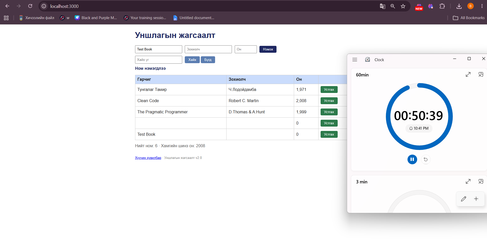

- **21:52 — Хайлтын талбарт `clean` гэж жижиг үсгээр оруулаад “Хайх” дарав.** Анхны өгөгдөлд `Clean Code` байгаа ч хүснэгтэд үр дүн гараагүй; толгой мөр үлдэж, номын мөр алга болов. Хүлээгдсэн нь том/жижиг үсэг ялгалгүй хайж `Clean Code`-г харуулах. Энэ нь хайлт том/жижиг үсэг ялгаж байж болзошгүйг харуулсан; bug report болгохын өмнө ижил хайлтыг шинэ эхний төлөвөөс давтан баталгаажуулна.

  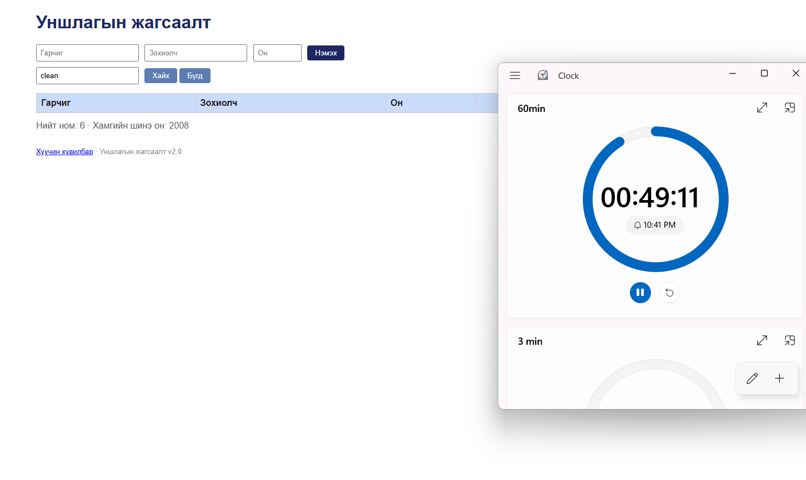

- **21:53 — Ижил хайлтын үгийг `Clean` гэж том `C`-ээр хайв.** `Clean Code` нэг мөрөөр гарч ирэв. Өмнөх минутын `clean` хайлт ямар ч мөр харуулаагүй тул хайлт том/жижиг үсэг ялгаж байгааг харьцуулалтаар батлав. Хүлээгдсэн нь хоёр тохиолдолд хоёуланд нь `Clean Code` гарах. Энэ нь тусдаа хайлтын согог; шинэ эхний төлөвөөс хоёр хайлтыг дахин дагаж эцсийн bug report-ийг баталгаажуулна.

  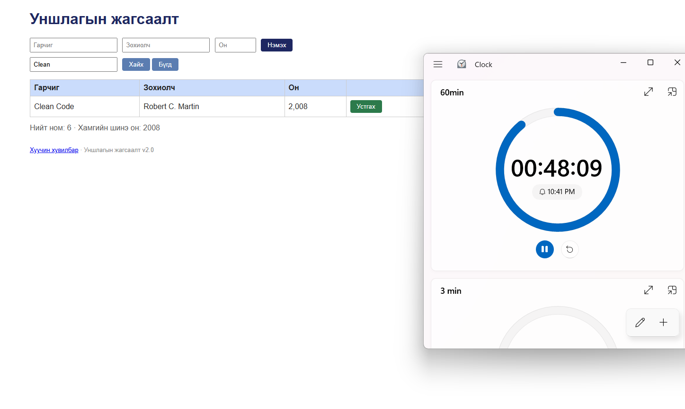

- **21:54 — “Бүгд” товчийг дарж бүх номыг харуулав.** Хүснэгтэд 5 мөр (3 анхны ном, хоосон оролтоор нэмэгдсэн 1 мөр, зөвхөн гарчигтай нэмэгдсэн 1 мөр) харагдсан; “Нийт ном: 6” гэж байв. Хүлээгдсэн нь тоолуур хүснэгтийн мөрийн тоотой тэнцүү байх. Тоолуур нэгээр их хэвээр байгаа нь 21:41-д ажигласан тоолуурын зөрүүг дахин батлав.

  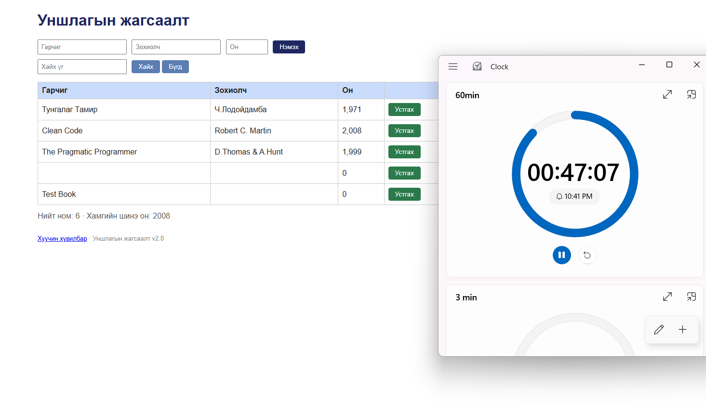

- **21:55 — `Test Book` мөрийн “Устгах” товчийг дарав.** Гарчигтай мөр хүснэгтээс алга болов. Гэвч мессеж “Ном нэмэгдлээ” гэж гарсан нь устгах үйлдлийг буруу мэдээлэв. Үйлдлийн дараа хүснэгтэд 4 мөр (үүнд хоосон мөр орно), тоолуурт 5 гэж харагдав. Хүлээгдсэн нь устгалд тохирсон мессеж гарч, тоолуур хүснэгтийн мөрийн тоотой тэнцүү байх. Мессежийн согогийг тусад нь, тоолуурын согогийг өмнөх ажиглалттай нэгтгэнэ.

  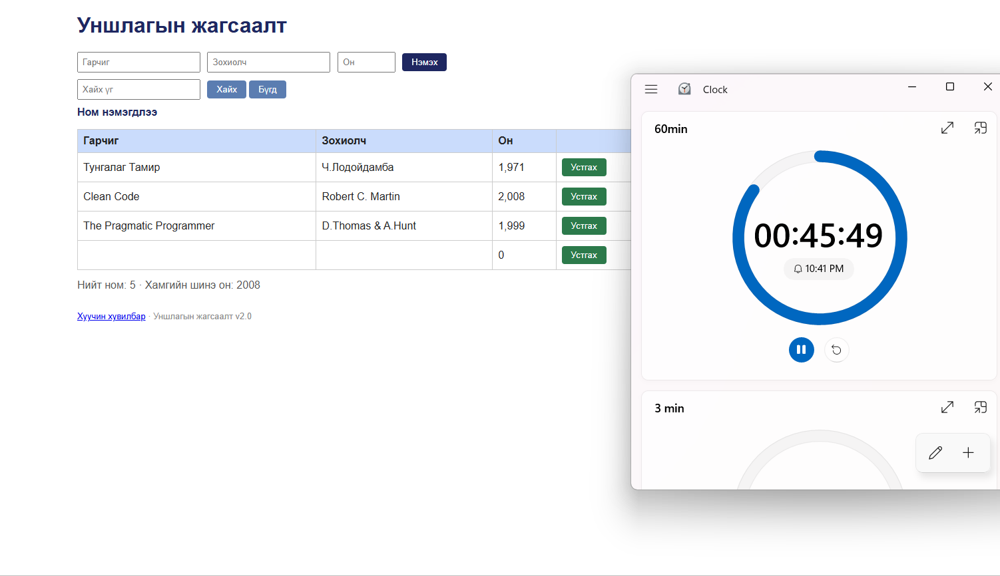

- **21:56 — “Хуучин хувилбар” холбоосыг дарав.** Хөтөч `/old` хаяг руу шилжиж, “Internal Server Error” хуудас харуулав. Хүлээгдсэн нь холбоос ажиллаж, хуучин хувилбарын хуудас нээгдэх. Энэ нь ажиллахгүй навигацийн тусдаа согог байж болзошгүй; тайланд оруулахдаа эхний төлөвөөс дахин баталгаажуулна.

  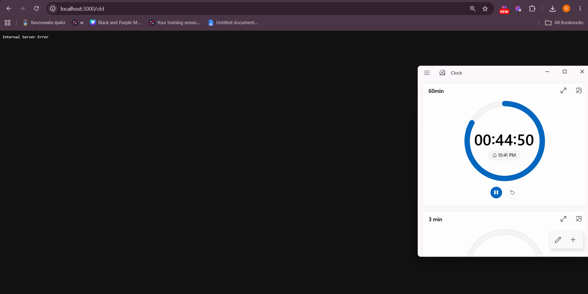

- **21:58 — Бүх талбарыг бөглөж, оныг `999` оруулаад “Нэмэх” дарав.** Ном хүснэгтэд нэмэгдэж, `999` хэвээр харагдав; амжилтын “Ном нэмэгдлээ” мессеж гарлаа. Хүлээгдсэн нь 1000-аас доош онтой номыг нэмэхгүй, ойлгомжтой алдаа харуулах. Энэ нь жилийн доод хязгаарын зөрүүг харуулж байна; тайланд оруулахдаа шинэ эхний төлөвөөс дахин баталгаажуулна.

  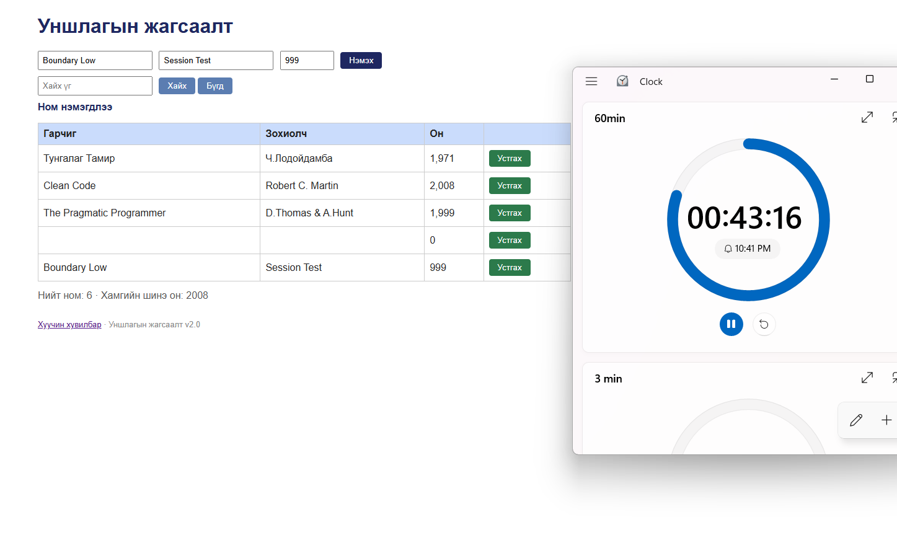

- **21:59 — Бүх талбарыг бөглөж, оныг `1000` оруулаад “Нэмэх” дарав.** Ном нэмэгдэж, он `1,000` гэж таслалтай харагдав. Амжилтын мессеж гарсан; хүснэгтэд 6 мөр байхад тоолуур 7 гэж харуулав. Хүлээгдсэн нь 1000 он зөвшөөрөгдөх, хүснэгтэд `1000` гэж энгийн тоогоор харагдах, тоолуур 6 байх. Хязгаарын доод утгыг зөвшөөрч байгааг, оны формат ба тоолуурын зөрүү үргэлжилж байгааг батлав.

  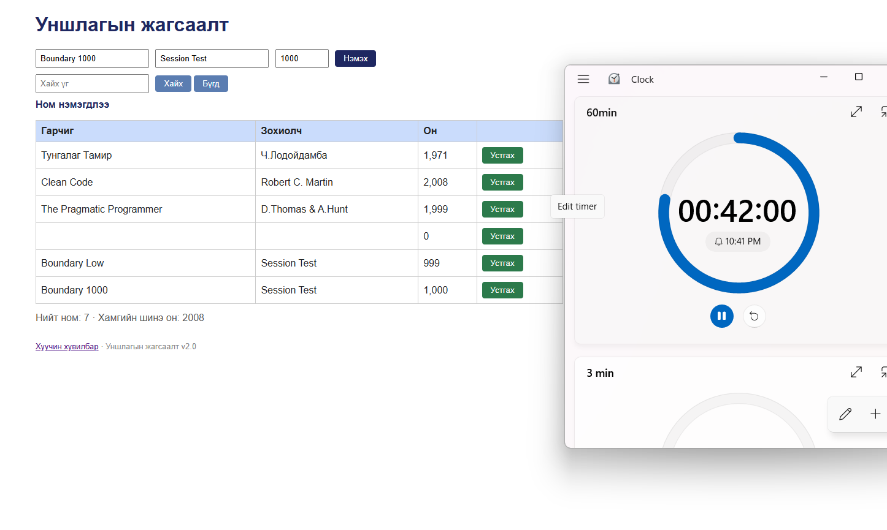

- **22:00 — Бүх талбарыг бөглөж, оныг `2100` оруулаад “Нэмэх” дарав.** Ном нэмэгдэж, он `2,100` гэж таслалтай харагдав. Хүлээгдсэн нь 2100 он зөвшөөрөгдөх ба хүснэгтэд `2100` гэж энгийн тоогоор харагдах. Дээд хязгаарын утга зөвшөөрөгдөж байгааг, оны формат зөрж байгааг батлав. Хүснэгтэд 7 мөр байхад тоолуур 8 гэж харуулав.

  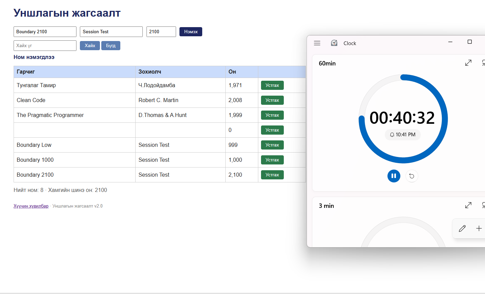

- **22:01 — Бүх талбарыг бөглөж, оныг `2101` оруулаад “Нэмэх” дарав.** Ном хүснэгтэд нэмэгдэж, `2,101` гэж харагдав. Хүлээгдсэн нь 2100-аас их онтой ном нэмэгдэхгүй, алдааны мессеж гарах. 999-ийн үр дүнтэй хамт жилийн доод/дээд хязгаарын шалгалт байхгүйг батлав.

  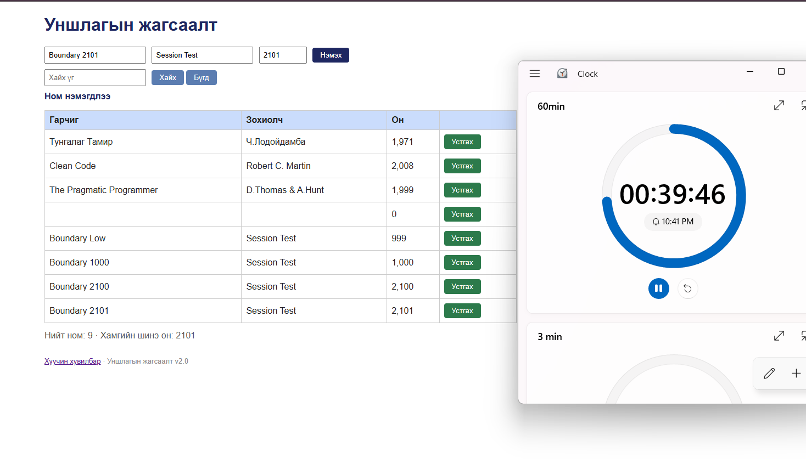

- **22:02 — Анхны номтой ижил гарчиг, зохиолч, он (`Clean Code`, `Robert C. Martin`, `2008`) оруулж “Нэмэх” дарав.** Ижил ном хүснэгтэд дахин нэмэгдэж, ижил хоёр мөр харагдав. Хүлээгдсэн нь ижил гарчиг, зохиолчтой ном давхар нэмэгдэхгүй байх. Давхардал шалгах согогийг батлав.

  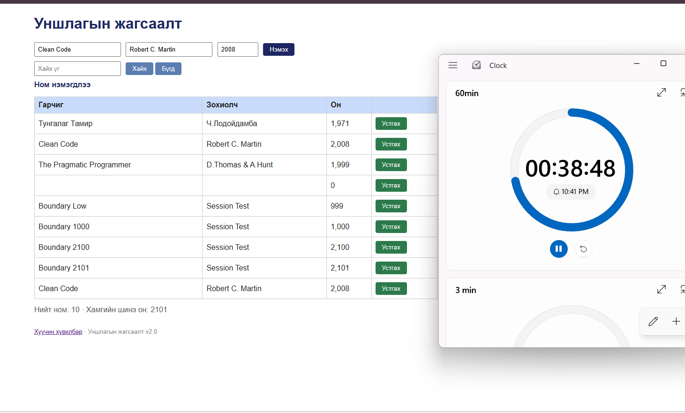

- **22:04 — Saboteur/API: `POST /api/books` руу эвдэрхий JSON (`{bad json`) илгээв.** `curl.exe -i`-ийн хариу `HTTP/1.1 200 OK` бөгөөд body нь `{"result":"OK"}` байв. Хүлээгдсэн нь буруу JSON биетэд HTTP 400 алдаа буцаах. API-ийн зан төлөвийн согог батлагдав; бүтэн гаралт `evidence/bug-14-curl.txt` дотор хадгалагдсан.

- **22:06 — Хайлтын талбарт `robert` гэж жижиг үсгээр оруулаад “Хайх” дарав.** Анхны өгөгдөлд `Robert C. Martin` зохиогчтой `Clean Code` байгаа ч хүснэгтэд мөр гараагүй. Хүлээгдсэн нь зохиогчийн нэрийг том/жижиг үсэг ялгалгүй хайх. 21:52–21:53-ын гарчгийн хайлтын үр дүнтэй адил case-sensitive хайлтын согогийг зохиогчийн талбарт мөн ажиглав.

  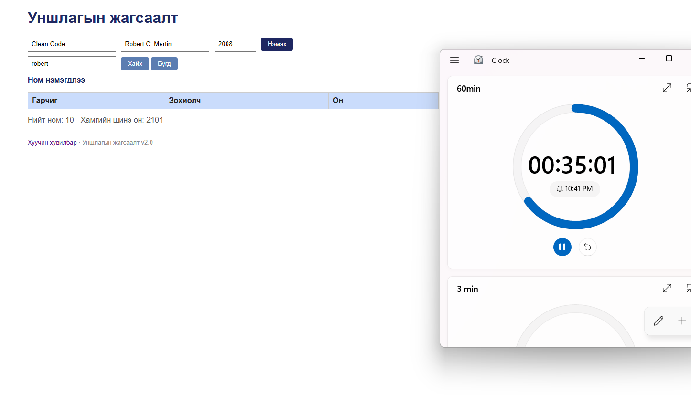

- **22:07 — Хайлтын талбарт `Robert` гэж том `R`-ээр хайв.** Хоёр `Clean Code` мөр гарч ирэв. Өмнөх `robert` хайлт хоосон байсан тул зохиогчийн хайлт том/жижиг үсэг ялгаж байгааг батлав; хоёр мөр нь өмнө нь давхар ном нэмэгдсэнтэй холбоотой.

  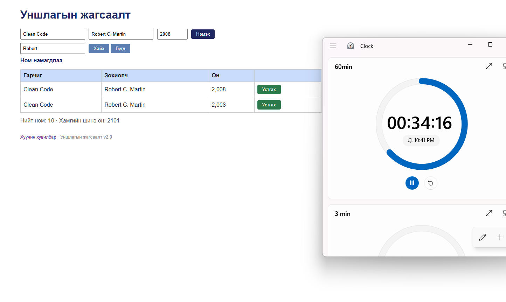

- **22:38 — Гарчиг `Fractional Year`, зохиогч `Robert C. Martin`, он `2024.5` гэж оруулаад “Нэмэх” дарав.** Ном нэмэгдэж, он `2,024.5` гэж харагдав. Хүлээгдсэн нь бүхэл тоон он л зөвшөөрч, он таслалгүй гарах. Бүхэл бус он хүлээн авсныг батлав; жилийн шалгалт, форматтай холбоотой зөрүүг bug report-д тусгана.

  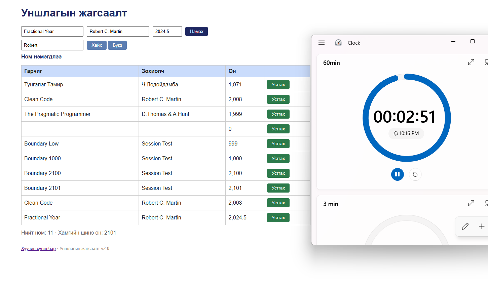

- **22:41 — 60 минутын таймер дуусаж, session-ийг хаав.** Таймерын screenshot дээр `-00:00:02` харагдсан.

## Session-ийн явц

Тестер нийт 17 шалгалт хийснээ мэдээлсэн. Таймер 21:41–22:41 тасралтгүй ажилласан бөгөөд саад, тасалдал гараагүй. GUI болон API аяллууд ашиглагдсан. 22:08–22:37 хооронд үргэлжлүүлсэн шалгалтуудын тус бүрийн алхам, үр дүнг raw тэмдэглэлд нарийвчлан буулгаагүй; дээр зөвхөн 22:38-ын шалгалт болон бусад цагтай ажиглалтыг тусгав.

## Session-ээс хойших дахин шалгалт

Тестер аппыг шинээр асааж, bug-уудын дахин гаргах алхмуудыг шалгахад бүгд өмнөх шигээ хэвээр байсныг мэдээлсэн. Дахин шалгалтад шинэ screenshot аваагүй; эхний session-ий screenshot болон API-ийн curl гаралт тайлангийн нотолгоо хэвээр байна.

